<picture>
  <source media="(prefers-color-scheme: dark)" srcset="assets/hero-dark.svg">
  
</picture>

**AI Solutions Engineer · Forward-deployed** | Applied AI, CXO discovery → production | Agentic & GenAI on messy enterprise stacks | Evals & guardrails before go-live | ~76% deflection through a 14× launch surge | Python · TypeScript · MCP

 

<picture>
  <source media="(prefers-color-scheme: dark)" srcset="assets/metrics-dark.svg">
  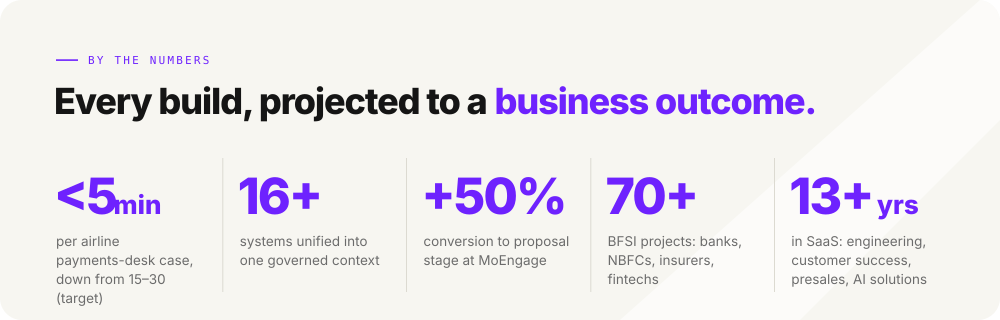
</picture>

<picture>
  <source media="(prefers-color-scheme: dark)" srcset="assets/maturity-dark.svg">
  
</picture>

<picture>
  <source media="(prefers-color-scheme: dark)" srcset="assets/evolution-dark.svg">
  
</picture>

<b>Text version: how I evolved</b>

- **2024–now · AI Solutions Engineer, DevRev → architect** (Generative & agentic AI, journey: ai evangelist). Pipeline: 16+ connectors → Governed context → Multi-agent → Evals + guardrails → outcomes: Hours saved ↑, Cost to serve ↓, Revenue ↑, CSAT ↑. concepts: Context layer, Multi-agent orchestration, Evals, Guardrails, Act-as identity, Retrieval, not stuffing. Learned: The model is a component; the solution is the product.
- **2021–2024 · Presales Manager → Lead Solutions Consulting, MoEngage · promoted Feb 2023** (Predictive ML, journey: expanding ai). Pipeline: SDKs + Data API → Warehouse sync → RFM segments → Sherpa models → outcomes: MAU / DAU ↑, Retention ↑, CTR ↑, CVR ↑. data in: Android/iOS/Web SDKs, Data API (server events), S3/SFTP imports, Warehouse (BigQuery/Snowflake/Redshift), CDP sources; sherpa (now merlin ai): Best Time to Send, Most Preferred Channel, Predictions (churn & conversion), Dynamic A/B (bandit-style), RFM segments (1–3 per axis), Flows (journeys). Learned: AI is only as good as the event data feeding it.

Explainers I used with customers (general techniques, not vendor claims): propensity models are typically gradient-boosted trees; behavioral clustering, e.g. k-means; a multi-armed bandit shifts traffic to the winning variant while still exploring; RFM scores recency, frequency and monetary value; aggregations turn event streams into features (counts, recency, rolling windows).

<picture>
  <source media="(prefers-color-scheme: dark)" srcset="assets/awards-dark.svg">
  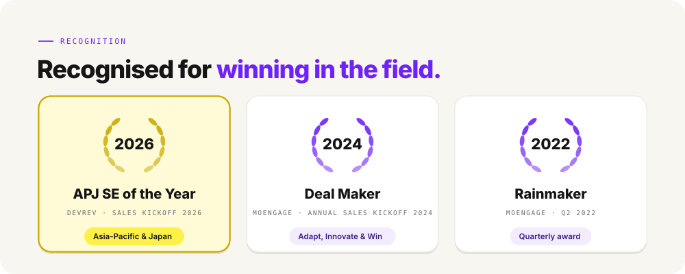
</picture>

<picture>
  <source media="(prefers-color-scheme: dark)" srcset="assets/approach-dark.svg">
  
</picture>

<b>Text version: my approach</b>

1. **Find the pain and baseline it**: minutes, cost, risk
2. **Map the process and systems**: who, what, where the data lives
3. **Unify the context**: connectors, governed objects, annotations
4. **Design the agent**: skills, tools, prompt contract, state outside the model
5. **Guardrails and humans at the right gates**: approvals, hard blocks, escalation
6. **Prove it before go-live**: shadow run, evals, targets
7. **Measure the outcome, then expand**: time, cost, revenue, risk

## AI use cases I've solutioned

Click any card to open its full page (architecture and step-by-step workflow), or expand an industry below.

<a href="use-cases/airlines.md"><picture><source media="(prefers-color-scheme: dark)" srcset="assets/tz-airlines-1-dark.svg">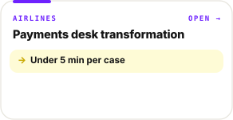</picture></a>
<a href="use-cases/bfsi-fintech.md"><picture><source media="(prefers-color-scheme: dark)" srcset="assets/tz-bfsi-fintech-1-dark.svg">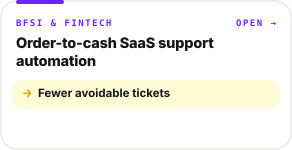</picture></a>
<a href="use-cases/bfsi-fintech.md"><picture><source media="(prefers-color-scheme: dark)" srcset="assets/tz-bfsi-fintech-2-dark.svg">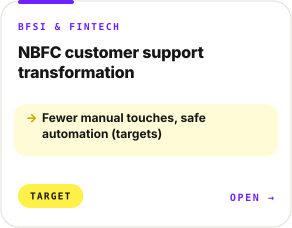</picture></a>
<a href="use-cases/retail-d2c.md"><picture><source media="(prefers-color-scheme: dark)" srcset="assets/tz-retail-d2c-1-dark.svg">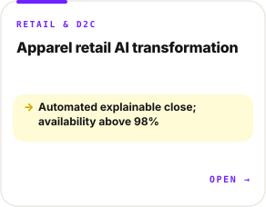</picture></a>
<a href="use-cases/retail-d2c.md"><picture><source media="(prefers-color-scheme: dark)" srcset="assets/tz-retail-d2c-2-dark.svg">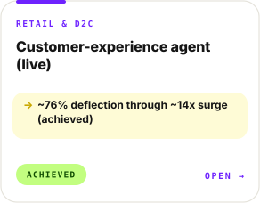</picture></a>
<a href="use-cases/automotive.md"><picture><source media="(prefers-color-scheme: dark)" srcset="assets/tz-automotive-1-dark.svg">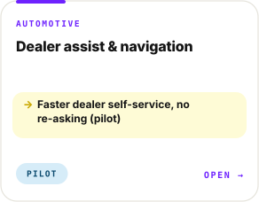</picture></a>
<a href="use-cases/pharma.md"><picture><source media="(prefers-color-scheme: dark)" srcset="assets/tz-pharma-1-dark.svg">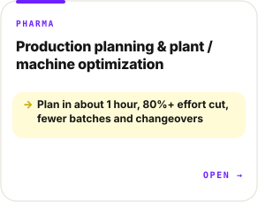</picture></a>
<a href="use-cases/pharma.md"><picture><source media="(prefers-color-scheme: dark)" srcset="assets/tz-pharma-2-dark.svg">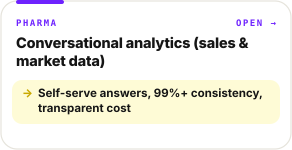</picture></a>
<a href="use-cases/it-services.md"><picture><source media="(prefers-color-scheme: dark)" srcset="assets/tz-it-services-1-dark.svg">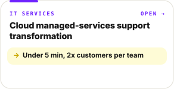</picture></a>
<a href="use-cases/marketing.md"><picture><source media="(prefers-color-scheme: dark)" srcset="assets/tz-marketing-1-dark.svg">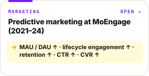</picture></a>

### Full details by industry

<picture><source media="(prefers-color-scheme: dark)" srcset="assets/acc-airlines-dark.svg"></picture>

<picture>
  <source media="(prefers-color-scheme: dark)" srcset="assets/uc-airlines-1-dark.svg">
  
</picture>

<picture>
  <source media="(prefers-color-scheme: dark)" srcset="assets/wf-airlines-1-dark.svg">
  
</picture>

Workflow steps as text: Payments desk transformation

1. **Trigger** (loop step 2): Desk agent enters the case number in the AI workspace → case fetched from the CRM
2. **System** (loop step 3): Queries the payment gateway and reservation system for payment and existing booking → status shown
3. **Decision** (loop step 4): Booking already exists? yes → step 9 / no → step 3a: payment failed? yes → [HUMAN] escalate to team lead / no → step 4
4. **Skill** (loop step 4): Searches flights on route and date, shows options → option list
5. **Human** (loop step 5): Agent confirms the flight, consulting the passenger if needed → selection
6. **Skill** (loop step 4): Reserves seats and enrols each passenger; applies senior discount; asks for infant allocation → enrolled passengers
7. **Human** (loop step 5): Agent confirms contact details ('yes') and the booking summary ('confirm') → approved summary
8. **Skill** (loop step 4): Generates payment link and sends by email and SMS; agent calls the passenger → link sent
9. **System** (loop step 3): Detects payment, retrieves booking reference, updates and closes the CRM case → closed case with audit trail
10. **Guardrail** (loop step 5): Payment taken but no booking, or an integration down → critical escalation to team lead and platform support in parallel
11. **Outcome** (loop step 7): Rebooked passenger and closed case in under 5 minutes (target) → less manual system switching

**Payments desk transformation** · Under 5 min per case (target)

- Problem: Paid-but-unbooked cases took 15–30 min across three systems
- AI did: Searched, reserved, enrolled, billed, retrieved booking, closed case
- Solution did: Integrated three systems; human confirm gates; escalation matrix and audits
- Architecture: CRM case → AI workspace chat → Payment gateway + reservation system → Human confirms → Payment link → booking ref → CRM auto-close

[Open the Airlines page](use-cases/airlines.md)

<picture><source media="(prefers-color-scheme: dark)" srcset="assets/acc-bfsi-fintech-dark.svg"></picture>

<picture>
  <source media="(prefers-color-scheme: dark)" srcset="assets/uc-bfsi-fintech-1-dark.svg">
  
</picture>

<picture>
  <source media="(prefers-color-scheme: dark)" srcset="assets/wf-bfsi-fintech-1-dark.svg">
  
</picture>

Workflow steps as text: Order-to-cash SaaS support PoC

1. **Trigger** (loop step 2): User opens the embedded chat widget with a verified identity (user and tenant) → session
2. **User** (loop step 2): Asks a product, how-to or account question → request
3. **Agent** (loop step 4): Answers from help articles, approved Q&A and SOPs, giving name, path and button label → answer
4. **Decision** (loop step 4): Account-specific issue? yes → step 5 / no → step 8
5. **Guardrail** (loop step 5): Tenant taken from verified identity only; any user-supplied tenant or customer ID is ignored → isolated scope
6. **Skill** (loop step 4): Runs read-only diagnosis queries (customer lookup, pool status, collectible status, ranking filter) → reasons
7. **Agent** (loop step 4): Explains each reason then the fix → explained answer
8. **Decision** (loop step 4): User confirms it helped? yes → close without ticket / no → step 9
9. **Human** (loop step 5): User confirms an agent-drafted, categorized summary; ticket is created and linked to the conversation; support reviews per tier → categorized ticket
10. **Outcome** (loop step 7): Fewer avoidable tickets and cleaner handoffs (pilot to measure) → lower support load

**Order-to-cash SaaS support PoC** · Fewer avoidable tickets (pilot will measure)

- Problem: Rising in-app tickets for questions articles or data could resolve
- AI did: Answered how-tos, diagnosed tenant issues, categorized tickets
- Solution did: Identity-bound tenant isolation, read-only queries, tiered automation, taxonomy
- Architecture: In-app chat, verified identity → Support agent + KB → Read-only diagnosis API → Confirm summary → Tiered automation

<picture>
  <source media="(prefers-color-scheme: dark)" srcset="assets/uc-bfsi-fintech-2-dark.svg">
  
</picture>

<picture>
  <source media="(prefers-color-scheme: dark)" srcset="assets/wf-bfsi-fintech-2-dark.svg">
  
</picture>

Workflow steps as text: NBFC customer support transformation

1. **Trigger** (loop step 2): Email lands in the service or complaints inbox → email integration creates one ticket per thread
2. **Workflow** (loop step 4): Fires once on ticket creation and calls the support agent → one AI action
3. **Guardrail** (loop step 5): Agent scans title, body, sender and display name for authority signals → authority flag
4. **Decision** (loop step 4): Authority or regulatory sender? yes → classify as complaint, zero reply, human queue / no → step 5
5. **Agent** (loop step 4): Classifies category and sub-category, applies inbox and email-type rules, searches KB, masks PII → structured output
6. **Workflow** (loop step 4): Sets category, sub-category, group atomically → routed ticket
7. **Decision** (loop step 4): Reply allowed and KB content found? yes → step 8 / no → fallback template or silent routing to human
8. **Agent** (loop step 4): Posts the multilingual KB reply as an external comment → customer email, stage awaiting customer
9. **Workflow** (loop step 4): No reply within N days → resolved then closed; customer follow-ups go to humans → closed or human-owned ticket
10. **Human** (loop step 5): Complaints and regulator mail handled in the complaints group → human resolution
11. **Outcome** (loop step 7): Fewer manual touches with regulator-safe automation (targets) → lower triage load

**NBFC customer support transformation** · Fewer manual touches, safe automation (targets)

- Problem: Every lender support email triaged by hand, regulators included
- AI did: Spotted authority senders, classified, wrote multilingual KB replies
- Solution did: Dual-inbox rules, authority block, one-action cost cap, supervised go-live
- Architecture: Service + complaints inboxes → Ticket-created trigger → Agent: authority scan, classify, mask PII → Category + reply → Human groups for complaints

[Open the BFSI & Fintech page](use-cases/bfsi-fintech.md)

<picture><source media="(prefers-color-scheme: dark)" srcset="assets/acc-retail-d2c-dark.svg"></picture>

<picture>
  <source media="(prefers-color-scheme: dark)" srcset="assets/uc-retail-d2c-1-dark.svg">
  
</picture>

<picture>
  <source media="(prefers-color-scheme: dark)" srcset="assets/wf-retail-d2c-1-dark.svg">
  
</picture>

Workflow steps as text: Apparel retail AI transformation

1. **Trigger** (loop step 2): Scheduled sync (daily by default, intraday where needed, monthly for close packs) → source pulls
2. **System** (loop step 3): Connectors pull read-only from ERP exports, DMS, POS, e-commerce, planning tool, HRMS and file drops, deltas only → staged data
3. **Guardrail** (loop step 5): Quality gate checks freshness, duplicates, missing keys and control totals → pass or block insights
4. **Decision** (loop step 4): Gate passed? yes → step 5 / no → insights blocked and data owner alerted
5. **System** (loop step 3): Maps to the common grain (SKU, pack size, channel, month) in the knowledge graph with lineage and permissions → trusted base
6. **Agent** (loop step 4): Finance and planning agents run versioned rules for price bridge, COGS, forecast and plan vs actual; model explains, drafts → draft outputs
7. **Human** (loop step 5): Finance and planners approve key outputs at each gate → approved figures
8. **Skill** (loop step 4): Availability control tower raises debounced alerts with causes and next actions → exceptions
9. **System** (loop step 3): Delivers via app, email, team chat, spreadsheet or PDF with data-as-of time; audit log and value ledger → governed delivery
10. **Outcome** (loop step 7): Automated explainable monthly close and earlier stock-out flags (targets) → time and working-capital gains

**Apparel retail AI transformation** · Automated explainable close; availability above 98% (targets)

- Problem: Two weeks a month of Excel to derive COGS and P&L
- AI did: Explained variances, drafted outputs, flagged availability exceptions (proposed)
- Solution did: Unified sources, quality gates, versioned finance rules, lineage, shadow runs
- Architecture: ERP · DMS · POS · e-commerce → Sync connectors + quality gates → Knowledge graph → Area agents + workflow engine → App · chat · export

<picture>
  <source media="(prefers-color-scheme: dark)" srcset="assets/uc-retail-d2c-2-dark.svg">
  
</picture>

<picture>
  <source media="(prefers-color-scheme: dark)" srcset="assets/wf-retail-d2c-2-dark.svg">
  
</picture>

Workflow steps as text: Customer-experience agent (live)

1. **Trigger** (loop step 2): Shopper sends a message on messaging or email → conversation opened with unified identity and cross-channel memory
2. **Agent** (loop step 4): Understands the request in natural language and picks a skill → skill call
3. **Skill** (loop step 4): Reads live order, tracking, refund or catalogue data from the source systems → verified facts
4. **Decision** (loop step 4): Is the request an action (return, exchange, cancel)? yes → step 5 / no → step 8
5. **Skill** (loop step 4): Checks per-item eligibility against window and policy → verdict
6. **Decision** (loop step 4): Eligible? yes → step 7 / no → step 9
7. **Skill** (loop step 4): Files the return/exchange or cancels the unshipped order and triggers the refund → record in order and returns systems
8. **Agent** (loop step 4): Replies with status, answer or product results → resolved conversation (deflected)
9. **Human** (loop step 5): Receives handover with sentiment and severity classification, works the chat or ticket with SLA and CSAT → human resolution
10. **Outcome** (loop step 7): Self-served conversation or escalated case with full context → deflection and zero broken journeys

**Customer-experience agent (live)** · ~76% deflection through ~14x surge (achieved)

- Problem: Brittle 95-node bot could not absorb launch-surge support
- AI did: Chose skills; answered orders, returns, refunds in natural language
- Solution did: Unified four systems; one re-skinnable agent; human escalation wired
- Architecture: Storefront · shipping · returns · tracking → Sync layer: one customer record → Identity + cross-channel memory → CX agent, 8 skills → WhatsApp + email; human team

[Open the Retail & D2C page](use-cases/retail-d2c.md)

<picture><source media="(prefers-color-scheme: dark)" srcset="assets/acc-automotive-dark.svg"></picture>

<picture>
  <source media="(prefers-color-scheme: dark)" srcset="assets/uc-automotive-1-dark.svg">
  
</picture>

<picture>
  <source media="(prefers-color-scheme: dark)" srcset="assets/wf-automotive-1-dark.svg">
  
</picture>

Workflow steps as text: Dealer assist & navigation

1. **Trigger** (loop step 2): Dealer opens the support chat in the DMS → greeting and main menu
2. **User** (loop step 2): Taps one of 5 entry buttons → use case chosen
3. **Workflow** (loop step 4): Shows 1-2 sub-menus of error, reason or option buttons (max 3 taps) → scenario identified
4. **Decision** (loop step 4): Issue listed? yes → step 5 / no → step 5 with the Others path (open describe-your-issue mode)
5. **Workflow** (loop step 4): Talk-to-agent node passes context: use case, scenario, path, start turn, already-answered list → agent invoked
6. **Guardrail** (loop step 5): Dealer and branch IDs come from the DMS session and are never asked; no re-asking of menu answers → clean first turn
7. **Agent** (loop step 4): Sends the first scripted instruction or data request, then runs the procedure sheet from the set turn → resolution steps or collected details
8. **Decision** (loop step 4): Resolved by the instructions? yes → step 9 / no → agent continues the sheet or hands the details to support
9. **Agent** (loop step 4): Closes with outcome, reason and a 1-5 star rating → closing record
10. **Outcome** (loop step 7): Dealer reaches the right procedure in at most 3 taps without repeated questions → faster self-service

**Dealer assist & navigation** · Faster dealer self-service, no re-asking (pilot)

- Problem: Dealers hit repeat system errors with scripted fixes
- AI did: Ran the right procedure from a pre-set starting turn
- Solution did: Button tree, 35 handoff contracts, no-re-ask context payloads
- Architecture: Dealer-system chat widget → Greeting + 5 buttons → Handoff context payload → Agent runs procedure → Outcome + rating

[Open the Automotive page](use-cases/automotive.md)

<picture><source media="(prefers-color-scheme: dark)" srcset="assets/acc-pharma-dark.svg"></picture>

<picture>
  <source media="(prefers-color-scheme: dark)" srcset="assets/uc-pharma-1-dark.svg">
  
</picture>

<picture>
  <source media="(prefers-color-scheme: dark)" srcset="assets/wf-pharma-1-dark.svg">
  
</picture>

Workflow steps as text: Production planning & plant / machine optimization

1. **Trigger** (loop step 2): Planner asks in chat, or the monthly/weekly schedule fires → planning request
2. **System** (loop step 3): Exports from ERP, validated-batch-size system, quality-event system and validation planner load as-is into linked objects → reconciled data
3. **Skill** (loop step 4): Readiness skill checks master documents, MES recipe, open quality items, equipment requalification and materials per line → Ready / At risk / Blocked with blocker and owner
4. **Skill** (loop step 4): Batch-and-machine skill applies R1-R3 to demand and rounds to whole batches → batch sizes
5. **Guardrail** (loop step 5): Only equipment validated for the batch size and in date on requalification is used; others flagged with reason → compliant assignment
6. **Skill** (loop step 4): Groups batches sharing a blend to reduce non-serial changeovers → sequence and changeover saving
7. **Decision** (loop step 4): Any line blocked or equipment lapsed? yes → flag with source record for the owner / no → include in draft plan
8. **Agent** (loop step 4): Produces the machine-level draft plan with rationale per batch → plan pack
9. **Human** (loop step 5): Planner and quality SME review and approve; no write-back to source systems → approved plan
10. **Outcome** (loop step 7): Draft in about one hour and plan ready earlier, with zero violations (targets) → planner capacity released

**Production planning & plant / machine optimization** · Plan in about 1 hour, 80%+ effort cut, fewer batches and changeovers (targets)

- Problem: 16–17 planners took 10 days on monthly batch and machine plans in spreadsheets
- AI did: Applied batch rules, checked readiness and equipment qualification, grouped batches, drafted machine-level plan
- Solution did: Linked custom objects, shadow run, zero-violation guardrail, accuracy and ROI measurement
- Architecture: ERP + quality exports → 11 linked custom objects → Planning agent: readiness + batch skills → Plan pack → Planner + QA approve

<picture>
  <source media="(prefers-color-scheme: dark)" srcset="assets/uc-pharma-2-dark.svg">
  
</picture>

<picture>
  <source media="(prefers-color-scheme: dark)" srcset="assets/wf-pharma-2-dark.svg">
  
</picture>

Workflow steps as text: Conversational analytics (sales & market data)

1. **Trigger** (loop step 2): Business user asks a question in natural language → request with persona
2. **Guardrail** (loop step 5): Persona access control and region/brand scope applied before any query → scoped request
3. **System** (loop step 3): Catalog sync pulls table and column metadata from Google BigQuery → governed metadata catalog
4. **Agent** (loop step 4): Reads guidance, synonym map and field annotations; resolves metric and entities → query plan
5. **Decision** (loop step 4): Native text-to-SQL can see the custom fields? yes → step 6 / no → step 7
6. **Skill** (loop step 4): Generates SQL at runtime from the catalog and runs it on BigQuery → result set
7. **Skill** (loop step 4): Calls the domain query skill or cross-domain join skill → result set
8. **Agent** (loop step 4): Answers with table, period and scope using business labels, refusing schema enumeration and out-of-scope data → answer
9. **System** (loop step 3): Logs tokens, cost and response time per query → cost and latency record
10. **Human** (loop step 6): QA reviewers score the harness run against ground truths computed outside the platform → pass rate
11. **Outcome** (loop step 7): Self-serve answers with consistency to certified reports and transparent cost (targets) → fewer analyst tickets

**Conversational analytics (sales & market data)** · Self-serve answers, 99%+ consistency, transparent cost (targets)

- Problem: Business users queue behind central analysts for sales and market answers
- AI did: Answered multi-domain questions in natural language
- Solution did: Catalog sync of BigQuery metadata, semantic layer + annotations, runtime query generation, persona access, cost logging
- Architecture: Google BigQuery → Metadata catalog sync → Semantic layer + annotations → Runtime query generation → Analytics answers + cost log

[Open the Pharma page](use-cases/pharma.md)

<picture><source media="(prefers-color-scheme: dark)" srcset="assets/acc-it-services-dark.svg"></picture>

<picture>
  <source media="(prefers-color-scheme: dark)" srcset="assets/uc-it-services-1-dark.svg">
  
</picture>

<picture>
  <source media="(prefers-color-scheme: dark)" srcset="assets/wf-it-services-1-dark.svg">
  
</picture>

Workflow steps as text: Cloud managed-services support transformation

1. **Trigger** (loop step 2): Observability platform raises an alert, or a ticket arrives by email, portal or team chat → event
2. **System** (loop step 3): Auto incident tracking: alerts are correlated, de-duplicated and opened as a tracked incident linked to affected tickets → incident
3. **Workflow** (loop step 4): Fires once on creation and calls the main agent → one AI action
4. **Agent** (loop step 4): AI triage: scans for P1/P2 emergency signals, classifies type, category, priority → structured output
5. **Decision** (loop step 4): P1/P2 or change request? yes → step 6 / no → step 7
6. **Guardrail** (loop step 5): No AI reply; route to on-call queue or approval board → human-only handling
7. **Skill** (loop step 4): Searches KB and runbooks; for alerts, graph lookup and on-demand cloud log and metric pulls → grounded context
8. **Agent** (loop step 4): Drafts the reply or customer notification and SOP checklist, or NO_RESPONSE → draft
9. **Human** (loop step 5): Reviews, personalises and approves send (100% on customer-impacting actions; supervised mode early on) → sent communication
10. **Workflow** (loop step 4): Awaiting-requester stage then auto-resolve and close after N days of silence; incident resolution closes linked tickets → closed records
11. **Outcome** (loop step 7): Alert-to-customer notice and human touch-time under 5 minutes (target) → more customers per team

**Cloud managed-services support transformation** · Under 5 min, 2x customers per team (targets)

- Problem: Tickets took 25–40 min of manual alert correlation and drafting
- AI did: Auto-tracked incidents from observability alerts, triaged and classified, drafted replies and SOP steps
- Solution did: Observability platform → auto incident tracking and AI triage; one-action workflow, P1/P2 hard block, human confirm gates
- Architecture: Observability alerts · email · portal → Auto incident tracking → Correlation + dedupe → AI triage: classify P1–P4, draft → Humans confirm; P1/P2 human-only

[Open the IT services page](use-cases/it-services.md)

<picture><source media="(prefers-color-scheme: dark)" srcset="assets/acc-marketing-dark.svg"></picture>

<picture>
  <source media="(prefers-color-scheme: dark)" srcset="assets/uc-marketing-1-dark.svg">
  
</picture>

**Predictive marketing at MoEngage (2021–24)** · MAU / DAU ↑ · lifecycle engagement ↑ · retention ↑ · CTR ↑ · CVR ↑ (achieved)

- Problem: Right message, right user, right time, right channel (BFSI and retail)
- AI did: Sherpa (now Merlin AI): Best Time to Send, Most Preferred Channel, Predictions, Dynamic A/B
- Solution did: SDKs + Data API + warehouse imports, RFM segments, Flows (journeys)
- Architecture: SDKs + Data API → Warehouse + S3/SFTP imports → RFM segments → Sherpa: BTS · MPC · predictions → Flows + Dynamic A/B

[Open the Marketing page](use-cases/marketing.md)

## Concepts

<b>How sync actually works: 9 concepts</b>

<picture>
  <source media="(prefers-color-scheme: dark)" srcset="assets/concepts-dark.svg">
  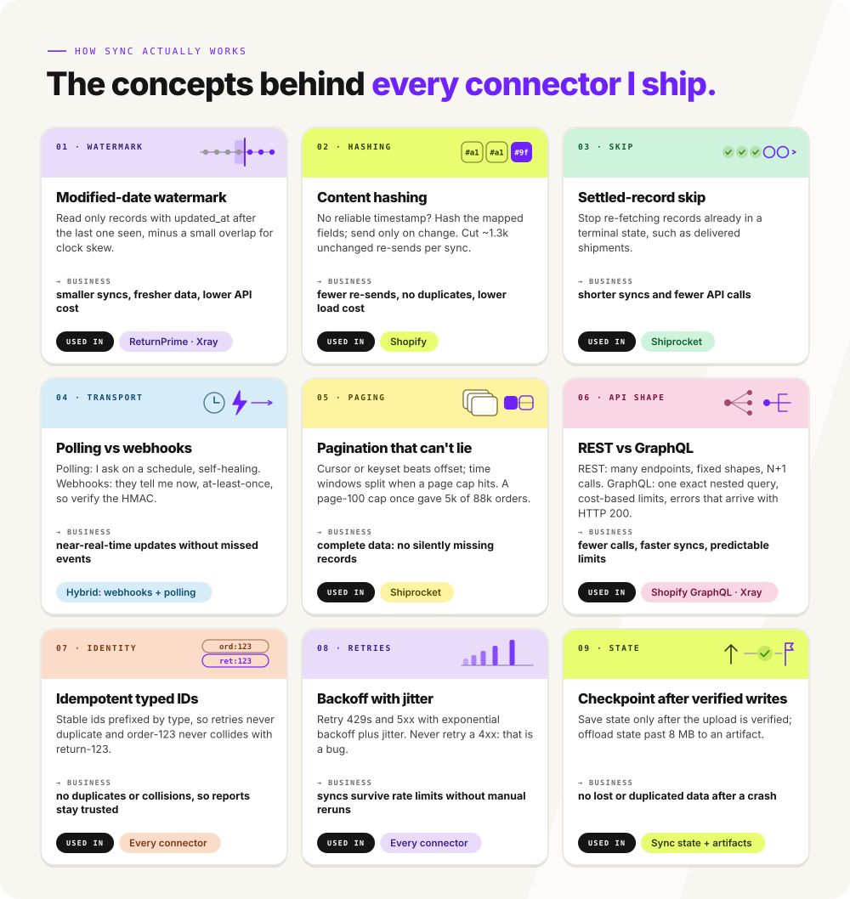
</picture>

1. **Modified-date watermark**: Read only records with updated_at after the last one seen, minus a small overlap for clock skew. *Business:* smaller syncs, fresher data, lower API cost. *Used in:* ReturnPrime · Xray.
2. **Content hashing**: No reliable timestamp? Hash the mapped fields; send only on change. Cut ~1.3k unchanged re-sends per sync. *Business:* fewer re-sends, no duplicates, lower load cost. *Used in:* Shopify.
3. **Settled-record skip**: Stop re-fetching records already in a terminal state, such as delivered shipments. *Business:* shorter syncs and fewer API calls. *Used in:* Shiprocket.
4. **Polling vs webhooks**: Polling: I ask on a schedule, self-healing. Webhooks: they tell me now, at-least-once, so verify the HMAC. *Business:* near-real-time updates without missed events. *Used in:* Hybrid: webhooks + polling.
5. **Pagination that can't lie**: Cursor or keyset beats offset; time windows split when a page cap hits. A page-100 cap once gave 5k of 88k orders. *Business:* complete data: no silently missing records. *Used in:* Shiprocket.
6. **REST vs GraphQL**: REST: many endpoints, fixed shapes, N+1 calls. GraphQL: one exact nested query, cost-based limits, errors that arrive with HTTP 200. *Business:* fewer calls, faster syncs, predictable limits. *Used in:* Shopify GraphQL · Xray.
7. **Idempotent typed IDs**: Stable ids prefixed by type, so retries never duplicate and order-123 never collides with return-123. *Business:* no duplicates or collisions, so reports stay trusted. *Used in:* Every connector.
8. **Backoff with jitter**: Retry 429s and 5xx with exponential backoff plus jitter. Never retry a 4xx: that is a bug. *Business:* syncs survive rate limits without manual reruns. *Used in:* Every connector.
9. **Checkpoint after verified writes**: Save state only after the upload is verified; offload state past 8 MB to an artifact. *Business:* no lost or duplicated data after a crash. *Used in:* Sync state + artifacts.

<b>How agents actually work: 12 concepts</b>

<picture>
  <source media="(prefers-color-scheme: dark)" srcset="assets/agents-dark.svg">
  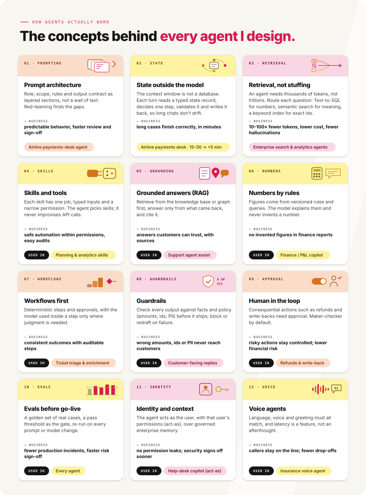
</picture>

1. **Prompt architecture**: Role, scope, rules and output contract as layered sections, not a wall of text. Red-teaming finds the gaps. *Business:* predictable behavior, faster review and sign-off. *Used in:* Airline payments-desk agent.
2. **State outside the model**: The context window is not a database. Each turn reads a typed state record, decides one step, validates it and writes it back, so long chats don't drift. *Business:* long cases finish correctly, in minutes. *Used in:* Airline payments desk · 15–30 → <5 min.
3. **Retrieval, not stuffing**: An agent needs thousands of tokens, not trillions. Route each question: Text-to-SQL for numbers, semantic search for meaning, a keyword index for exact ids. *Business:* 10–100× fewer tokens, lower cost, fewer hallucinations. *Used in:* Enterprise search & analytics agents.
4. **Skills and tools**: Each skill has one job, typed inputs and a narrow permission. The agent picks skills; it never improvises API calls. *Business:* safe automation within permissions, easy audits. *Used in:* Planning & analytics skills.
5. **Grounded answers (RAG)**: Retrieve from the knowledge base or graph first, answer only from what came back, and cite it. *Business:* answers customers can trust, with sources. *Used in:* Support agent assist.
6. **Numbers by rules**: Figures come from versioned rules and queries. The model explains them and never invents a number. *Business:* no invented figures in finance reports. *Used in:* Finance / P&L copilot.
7. **Workflows first**: Deterministic steps and approvals, with the model used inside a step only where judgment is needed. *Business:* consistent outcomes with auditable steps. *Used in:* Ticket triage & enrichment.
8. **Guardrails**: Check every output against facts and policy (amounts, ids, PII) before it ships; block or redraft on failure. *Business:* wrong amounts, ids or PII never reach customers. *Used in:* Customer-facing replies.
9. **Human in the loop**: Consequential actions such as refunds and write-backs need approval. Maker-checker by default. *Business:* risky actions stay controlled; lower financial risk. *Used in:* Refunds & write-back.
10. **Evals before go-live**: A golden set of real cases, a pass threshold as the gate, re-run on every prompt or model change. *Business:* fewer production incidents, faster risk sign-off. *Used in:* Every agent.
11. **Identity and context**: The agent acts as the user, with that user's permissions (act-as), over governed enterprise memory. *Business:* no permission leaks; security signs off sooner. *Used in:* Help-desk copilot (act-as).
12. **Voice agents**: Language, voice and greeting must all match, and latency is a feature, not an afterthought. *Business:* callers stay on the line; fewer drop-offs. *Used in:* Insurance voice agent.

<picture>
  <source media="(prefers-color-scheme: dark)" srcset="assets/stack-dark.svg">
  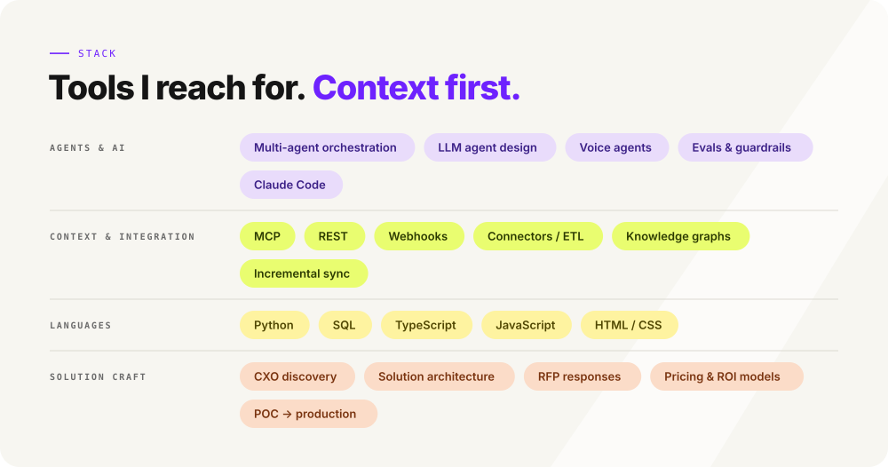
</picture>

<a href="https://www.linkedin.com/in/shivaji-m-d-ab983a65/recent-activity/articles/">
<picture>
  <source media="(prefers-color-scheme: dark)" srcset="assets/writing-dark.svg">
  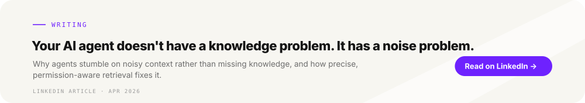
</picture>
</a>

Every visual is generated by [build_profile.py](build_profile.py) (stdlib Python; `python3 build_profile.py --preview`
renders previews). Client names are left out on purpose: industries and generic system types only.
