# Automotive: AI use cases I've solutioned

[← back to profile](../README.md)

<picture>
  <source media="(prefers-color-scheme: dark)" srcset="../assets/tabs-automotive-dark.svg">
  
</picture>

      

<picture>
  <source media="(prefers-color-scheme: dark)" srcset="../assets/uc-automotive-1-dark.svg">
  
</picture>

<picture>
  <source media="(prefers-color-scheme: dark)" srcset="../assets/wf-automotive-1-dark.svg">
  
</picture>

Workflow steps as text: Dealer assist & navigation

1. **Trigger** (loop step 2): Dealer opens the support chat in the DMS → greeting and main menu
2. **User** (loop step 2): Taps one of 5 entry buttons → use case chosen
3. **Workflow** (loop step 4): Shows 1-2 sub-menus of error, reason or option buttons (max 3 taps) → scenario identified
4. **Decision** (loop step 4): Issue listed? yes → step 5 / no → step 5 with the Others path (open describe-your-issue mode)
5. **Workflow** (loop step 4): Talk-to-agent node passes context: use case, scenario, path, start turn, already-answered list → agent invoked
6. **Guardrail** (loop step 5): Dealer and branch IDs come from the DMS session and are never asked; no re-asking of menu answers → clean first turn
7. **Agent** (loop step 4): Sends the first scripted instruction or data request, then runs the procedure sheet from the set turn → resolution steps or collected details
8. **Decision** (loop step 4): Resolved by the instructions? yes → step 9 / no → agent continues the sheet or hands the details to support
9. **Agent** (loop step 4): Closes with outcome, reason and a 1-5 star rating → closing record
10. **Outcome** (loop step 7): Dealer reaches the right procedure in at most 3 taps without repeated questions → faster self-service

**Dealer assist & navigation** · M2 · L2 (inferred) · Faster dealer self-service (no KPI stated)

- Problem: Dealers hit repeat system errors with scripted fixes
- AI did: Ran the right procedure from a pre-set starting turn
- Solution did: Button tree, 35 handoff contracts, no-re-ask context payloads
- Architecture: Dealer-system chat widget → Greeting + 5 buttons → Handoff context payload → Agent runs procedure → Outcome + rating

Anonymized: industries and generic system types only. Outcomes are labelled target, achieved, proposal or pilot exactly as the source work states them.
